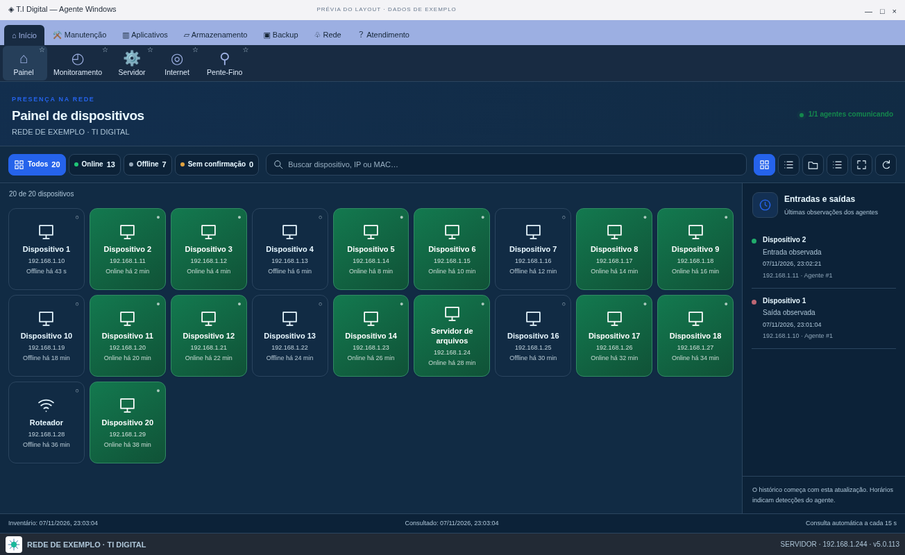

# Agente Windows — layout compacto

**[Baixar atualização para o cPanel](ATUALIZACAO_AGENTE_COMPACTO_CPANEL.zip?raw=true)** · [Instruções](LEIA_ANTES_AGENTE_COMPACTO.md) · [Códigos](codigo/) · [Validação](VALIDACAO_AGENTE_COMPACTO.md)

- Logo e nome da rede no rodapé, com opacidade reduzida quando a conexão não está confirmada.
- Menus e submenus menores, mantendo as duas faixas, favoritos e rolagem horizontal.
- Conteúdo sem as duas margens externas e sem os cantos arredondados do painel exterior.

O pacote contém **3 arquivos**. Extraia na raiz do sistema e **atualize/recompile o agente Windows**. Se usa release pré-compilada, gere e publique novamente essa release. O upload dos fontes no cPanel não modifica o executável já instalado.

A versão atual é preservada. Consulte a observação sobre a base disponível no guia; o código completo da instalação 5.0.113 não foi enviado. A extensão evita substituir a lógica principal e mantém os nomes de controles usados pela navegação e pela marca.

**Prévia composta — conectado, dados de exemplo:**

**Prévia composta — identidade apagada, dados de exemplo:**

[Compilação WinUI x64 aprovada: 0 erros e 0 avisos](https://github.com/marcosliraxx/GesTI/actions/runs/42436789216).

Não extraia o snapshot de validação no cPanel. Use somente o ZIP de atualização indicado acima.
