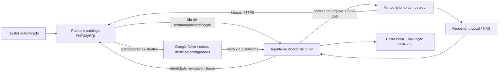

# Pesquisa técnica e plano de evolução — 07/11/2026

A pesquisa usou documentação primária de fabricantes e órgãos técnicos. A referência são mecanismos de proteção e recuperação; esta entrega não declara equivalência completa com suítes empresariais.

| Referência | O que orientou a implementação | Situação da entrega |
|---|---|---|
| [Google Drive: upload resumível](https://developers.google.com/workspace/drive/api/guides/manage-uploads) | Sessões, blocos e retomada por offset; tratamento de falhas sem reiniciar todo o plano. | Reutiliza o adaptador existente, com sessões vinculadas a plano/objeto, confirmação de blocos e tentativas limitadas. |
| [Google Drive: limites e quotas](https://developers.google.com/workspace/drive/api/guides/limits) | Capacidade e tráfego são controles diferentes. A documentação registra mudanças de quotas em maio de 2026 e exceções para projetos existentes; consulte o projeto efetivo. Para Google Workspace, a regra publicada inclui 750 GB/dia de upload/cópia por usuário, com condições descritas pelo Google. | Limite de banda no agente, retorno de falhas e tratamento de 429/5xx. Não há rate limiter global por todos os clientes da conta. |
| [Google Drive: revisões](https://developers.google.com/workspace/drive/api/guides/manage-revisions) | Revisões do Drive têm regras de expurgo e limites; não devem ser o único mecanismo de retenção de backup. | Objetos separados por SHA-256 e manifestos explícitos, em vez de depender só do histórico de revisões do Drive. |
| [Veeam: avaliação de segurança](https://bp.veeam.com/security/Assessment/) | Estratégia 3-2-1-1-0: cópias independentes, uma offline/imutável e ausência de erros aferida. | Permite planos Nuvem e Local/NAS. Não certifica uma estratégia 3-2-1-1-0 nem cria uma cópia imutável. |
| [Veeam: verificação de backups](https://helpcenter.veeam.com/docs/vbr/userguide/ahv_verify_backups.html) | A existência de uma cópia precisa ser complementada por verificação e teste de recuperação. O exemplo do fabricante trata seu próprio produto/plataforma. | Leitura integral com SHA-256 sob demanda e recuperação em pasta nova. Não inicia VM de laboratório nem comprova inicialização de aplicações. |
| [Acronis: validação de backups](https://www.acronis.com/en/support/documentation/AcronisCyberProtect_17_Cloud/validating-backups.html) | Separar conclusão da transferência de validação do conteúdo recuperável. | Estados separados e marca de verificação somente após leitura integral concluída. |
| [Microsoft: Volume Shadow Copy Service](https://learn.microsoft.com/en-us/windows-server/storage/file-server/volume-shadow-copy-service) | Backups consistentes de aplicações exigem coordenação de writers/requesters/providers; copiar arquivos abertos não substitui esse processo. | VSS não implementado. Exige exportações consistentes para aplicações e rejeita formatos comuns de bancos ativos/discos virtuais. |
| [AWS: S3 Object Lock](https://docs.aws.amazon.com/AmazonS3/latest/userguide/object-lock.html) | Imutabilidade exige suporte e configuração real de retenção/legal hold no armazenamento. | Integração S3 existente pode ser reutilizada para arquivos; Object Lock não é configurado nem verificado nesta versão. |
| [CISA: StopRansomware Guide](https://www.cisa.gov/sites/default/files/2023-10/StopRansomware-Guide-508C-v3_1.pdf) | Manter backups protegidos/offline e testar disponibilidade/integridade da recuperação. | Recuperação sem sobrescrita, validação de conteúdo e orientação para segunda cópia. Não há air gap automático. |

## Arquitetura entregue

O catálogo organiza o negócio; os provedores guardam objetos e manifestos. Não há upload de todo o arquivo para disco no cPanel. Local/NAS mantém objetos e manifestos localmente; a nuvem usa uma área própria por conta/rede/computador/plano/destino. A alteração de uma origem não sobrescreve os objetos anteriores. A mudança de destino conserva a configuração do ponto antigo no manifesto.

A credencial do agente não é um token OAuth do Google. O renderer local não recebe tokens OAuth, chaves comerciais ou URLs livres para execução. Restauração e configuração de novas origens passam pela sessão do gestor. O worker aceita somente os tipos de operação definidos; não executa comandos arbitrários enviados pelo servidor.

## Próximas etapas para uma oferta empresarial

1. **Recuperação de desastre da própria plataforma:** importação autenticada de manifestos, utilitário offline, backup periódico do catálogo/configuração, testes documentados de perda total do cPanel.
2. **Consistência de aplicações:** VSS com writers, políticas para SQL Server/Exchange/Hyper-V, exports nativos monitorados e testes em ambiente de laboratório. Imagem/bare metal é um projeto separado do backup por arquivo.
3. **Criptografia no cliente:** envelope encryption por cliente, recuperação/rotação de chaves e testes de perda/comprometimento. Não basta adicionar uma senha ao ZIP.
4. **Imutabilidade real:** S3 Object Lock/WORM, separação de identidades, políticas de retenção e proteção contra exclusão administrativa. Google Drive não deve receber um selo de imutável.
5. **Retenção física e GFS:** contagem de referências, marcação/coleta em duas etapas, período de segurança, pontos fixados, operações ativas e revisão auditável. Arquivar catálogo não é liberar armazenamento.
6. **Escala multiempresa:** orçamento de API/tráfego por provedor e cliente, filas globais com justiça, limites comerciais, observabilidade e custos. Uma conta de 24 TB pode ser um gargalo comum de todos os clientes.
7. **Verificação recorrente:** seleção amostral/integral programada, cópias independentes, testes de restauração por aplicação e indicadores de RTO medidos.
8. **Operação e compliance:** notificações configuráveis, trilha exportável, segregação por função, proteção dos logs, região de dados, contratos e política de privacidade informando os provedores efetivos.

Esses itens estão separados daquilo que o código já executa. A implantação inicial deve começar com pastas de teste e avançar após uma restauração conferida no servidor real.
