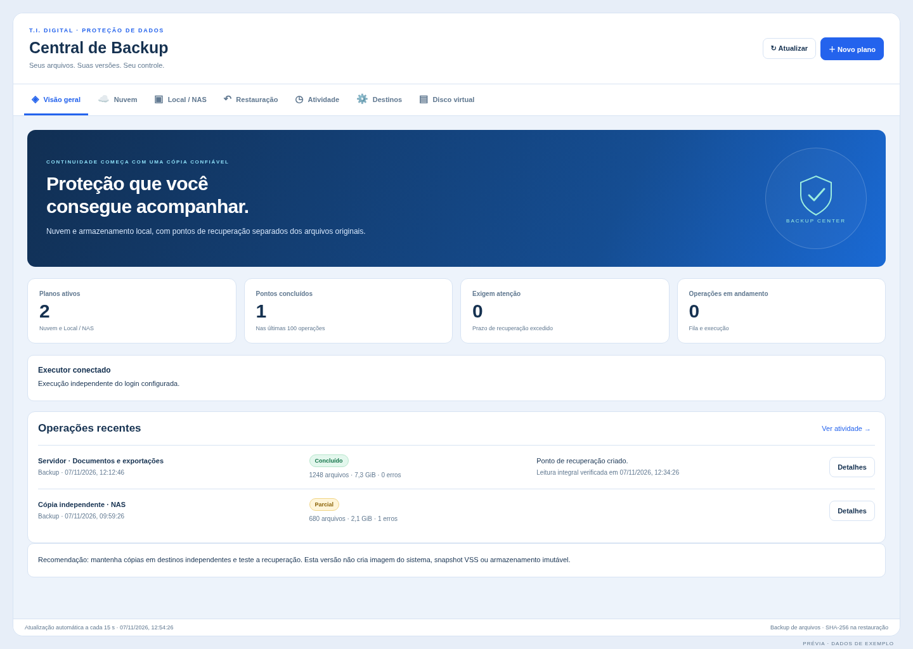
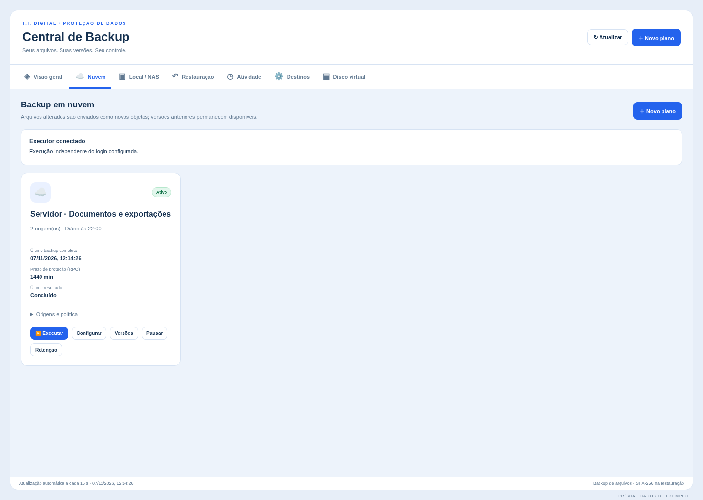
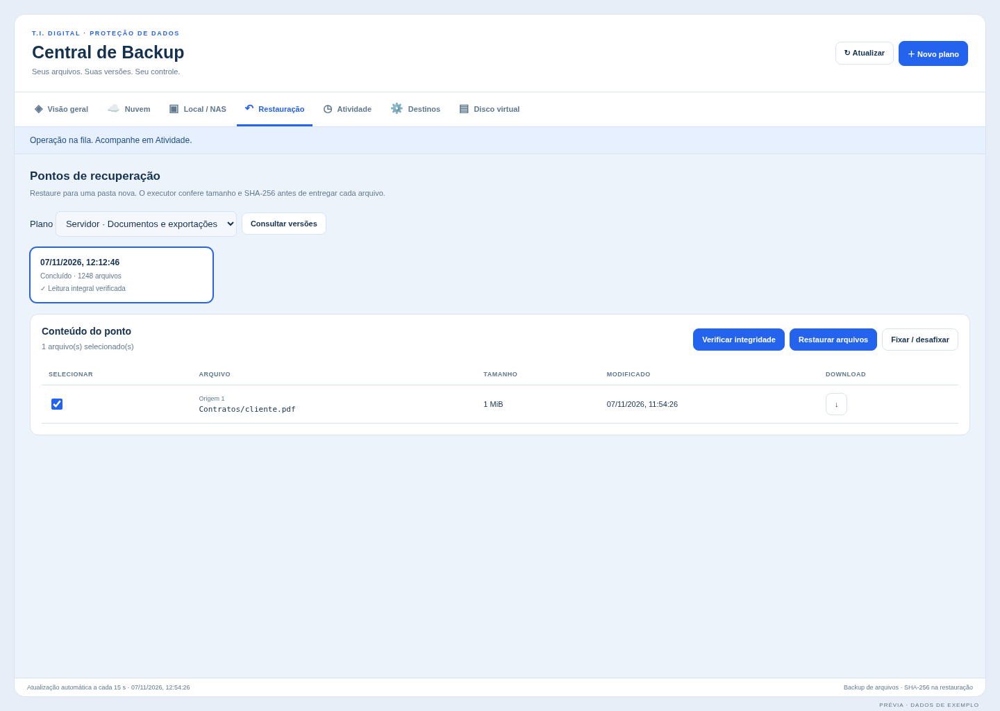

# Central de Backup — T.I. Digital 5.0.108

**[Baixar o ZIP para atualizar o cPanel](ATUALIZACAO_BACKUP_CPANEL.zip?raw=true)** · [Guia de instalação](LEIA_ANTES_BACKUP.md) · [Pesquisa e evolução](PESQUISA_E_EVOLUCAO_BACKUP.md) · [Validação](VALIDACAO_BACKUP.md)

Área própria na plataforma e no agente: **Nuvem · Local/NAS · Restauração · Atividade · Destinos · Disco virtual**. Reutiliza a integração Google Drive existente. Inclui planos, agendamento, cópias incrementais por arquivo, versões, manifesto independente, recuperação com SHA-256 e executor opcional antes do login.

[Ver os códigos atualizados](codigo/) · [Testes](testes/) · [GitHub Actions aprovado](https://github.com/marcosliraxx/GesTI/actions/runs/42374486367)

O ZIP de produção contém 33 arquivos novos/alterados para mesclar na raiz do sistema. Após o upload, atualize/recompile o agente. Para execução antes do login, instale explicitamente a tarefa usando `INSTALAR_BACKUP_SERVICO.ps1` na pasta publicada. Leia o guia antes de ativar planos.

**Escopo:** backup de arquivos. Não inclui VSS, imagem/bare metal, criptografia ponta a ponta ou imutabilidade. Retenção arquiva o catálogo e não apaga objetos físicos. Faça uma restauração de teste no servidor real antes de ampliar o uso.

`VALIDACAO_BACKUP_FONTES_WINDOWS.zip` é um snapshot completo para testes/compilação. **Não deve ser extraído no cPanel.** A raiz antiga do repositório não é o pacote desta entrega; use esta pasta e o ZIP indicado.

Para repetir os testes do núcleo: `dotnet run --project testes/BackupTests.csproj -c Release`. Os testes de servidor estão no snapshot e são executados pelo workflow com MySQL isolado. Para a interface, instale Playwright em um ambiente de desenvolvimento, ajuste `executablePath` do Chromium conforme a máquina e execute `node testes/browser.cjs`; os arquivos de prévia são escritos em `backup-previews/`.
