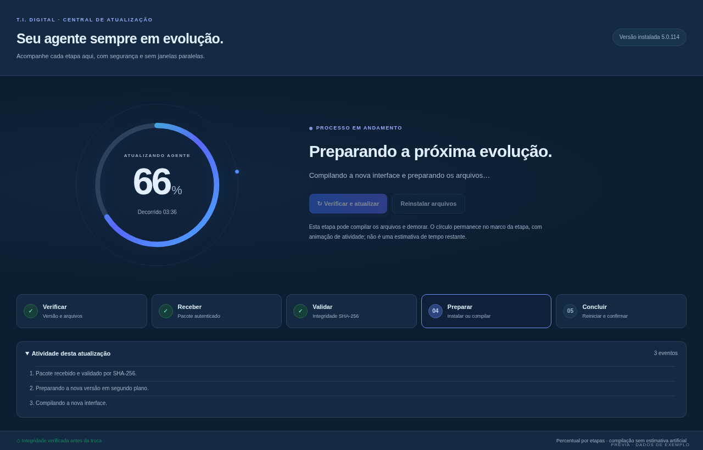

# Central de atualização integrada ao agente

**[Baixar ZIP para o cPanel](ATUALIZACAO_CENTRAL_ATUALIZACAO_CPANEL.zip?raw=true)** · [Instruções](LEIA_ANTES_CENTRAL_ATUALIZACAO.md) · [Códigos](codigo/) · [Validação](VALIDACAO_CENTRAL_ATUALIZACAO.md)

Novo menu **Atualização**, com círculo percentual animado, etapas, tempo decorrido e histórico. O atalho de atualização da faixa superior abre a mesma área.

Download, validação e preparação/compilação são acompanhados dentro do agente. Um aplicador oculto executa a troca final, que exige uma breve reinicialização. O estado é retomado no agente; a conclusão da instalação depende da confirmação da nova instância.

Extraia o ZIP de **13 arquivos** na raiz do sistema e atualize/recompile o agente. Para releases pré-compiladas, gere e publique novamente a release. O pacote preserva a versão central e o layout compacto anterior.

**Primeira migração:** o executável atualmente instalado ainda pode abrir a janela antiga para instalar esta central. Depois de instalada, as próximas atualizações usam a área interna. Leia o guia antes de distribuir.

[Windows x64: compilação aprovada, 0 avisos e 0 erros](https://github.com/marcosliraxx/GesTI/actions/runs/42439527522). Os testes usam recibos, processos e estados simulados; não houve atualização de uma instalação de produção.

Não extraia o snapshot de validação no cPanel. Use somente o ZIP de atualização indicado acima.
