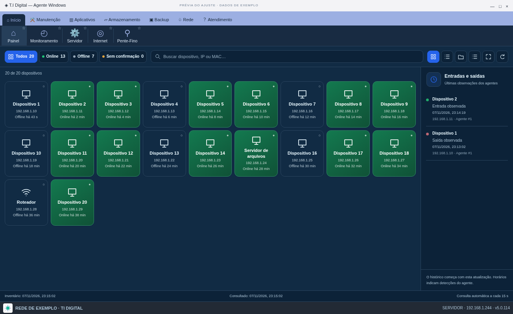

# Submenus uniformes e Painel direto

**[Baixar ZIP atualizado](ATUALIZACAO_SUBMENUS_PAINEL_CPANEL.zip?raw=true)** · [Instruções](LEIA_ANTES_SUBMENUS_PAINEL.md) · [Códigos](codigo/) · [Validação](VALIDACAO_SUBMENUS_PAINEL.md)

- Linha divisória igual entre cada item do submenu; separadores antigos por grupo ficam ocultos.
- Destaque do submenu ativo com cantos retos.
- Painel começa direto nos filtros e na busca, sem a faixa “Presença na rede / Painel de dispositivos / nome da rede”.

Aplique sobre o ajuste compacto anterior. Extraia o ZIP de **dois arquivos** na raiz do sistema e depois **atualize/recompile o agente Windows**. Se usa release pré-compilada, gere e publique novamente essa release. A versão atual é preservada.

[Compilação Windows aprovada](https://github.com/marcosliraxx/GesTI/actions/runs/42437681359). Não extraia o snapshot de validação no cPanel.
