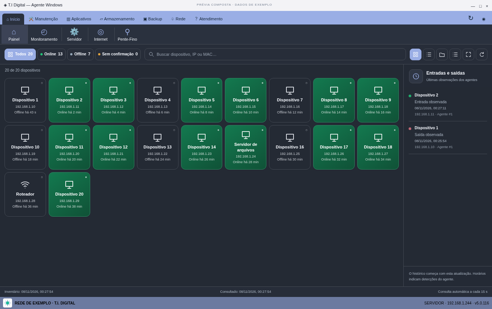
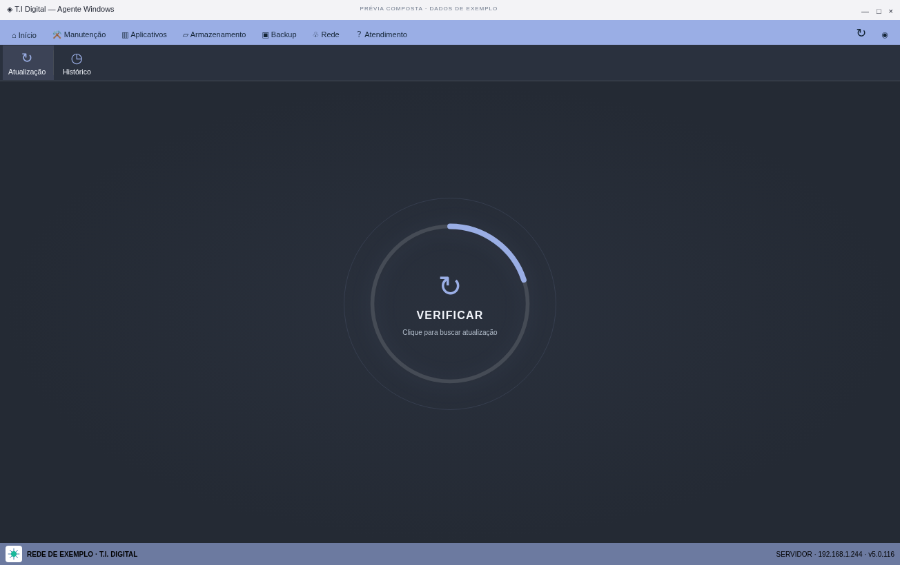
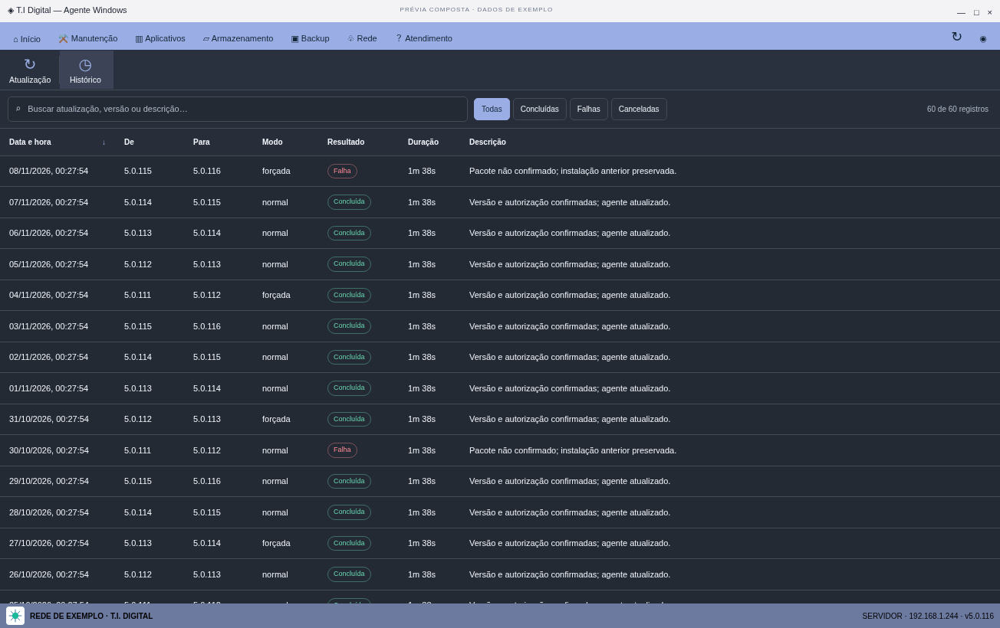
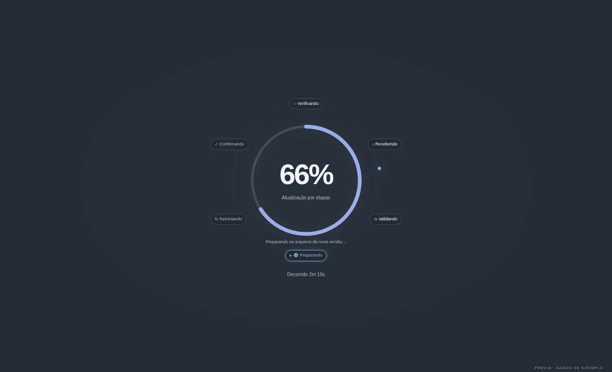
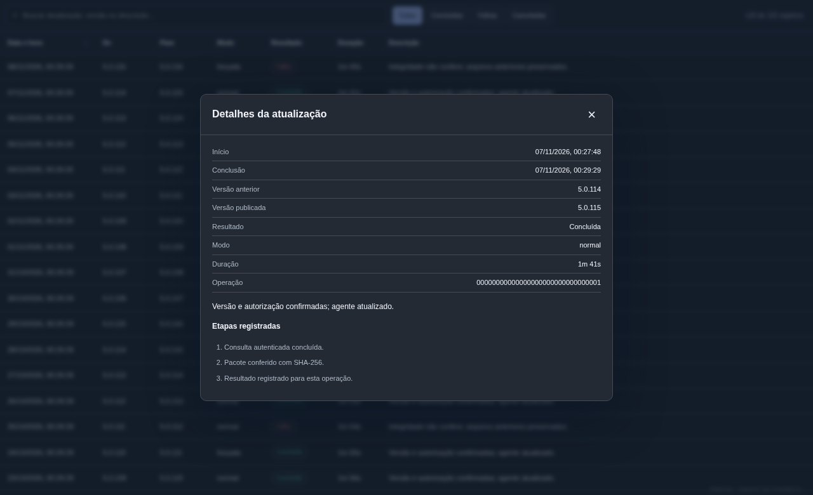

# Temas por área e atualização com histórico

**[Baixar ZIP para o cPanel](ATUALIZACAO_TEMAS_HISTORICO_CPANEL.zip?raw=true)** · [Instruções](LEIA_ANTES_TEMAS_HISTORICO.md) · [Códigos](codigo/) · [Validação](VALIDACAO_TEMAS_HISTORICO.md)

- Área 1 segue o Windows; áreas 2–10 seguem o tema de Admin/Configurações, com as relações de cor solicitadas.
- Atualização sai da barra principal e fica acessível pelo ícone da ponta. Os submenus são **Atualização** e **Histórico**.
- Círculo central clicável para consultar a publicação, sem instalar. Depois aparecem **Atualizar** e **Reinstalar arquivos**. Durante o progresso, as etapas ficam compactas ao redor do círculo.
- Histórico local persistente, busca/filtros em uma barra, colunas ordenáveis, detalhes em modal e rolagem restrita à grade.

Extraia o ZIP de **16 arquivos** na raiz do sistema e depois atualize/recompile o agente. Se usa uma release pré-compilada, gere e publique novamente essa release. **Inclua a API atualizada**, necessária para separar a consulta da instalação. O pacote preserva a versão atual.

O histórico guarda os últimos 1.000 registros do perfil Windows, começa a registrar novas operações e importa o último estado disponível da central anterior. Não inventa registros antigos sem recibo confiável.

[Compilação Windows e testes da API aprovados](https://github.com/marcosliraxx/GesTI/actions/runs/42442928087). Não extraia `VALIDACAO_TEMAS_HISTORICO_WINDOWS.zip` no cPanel: esse snapshot é só para compilação e testes.
