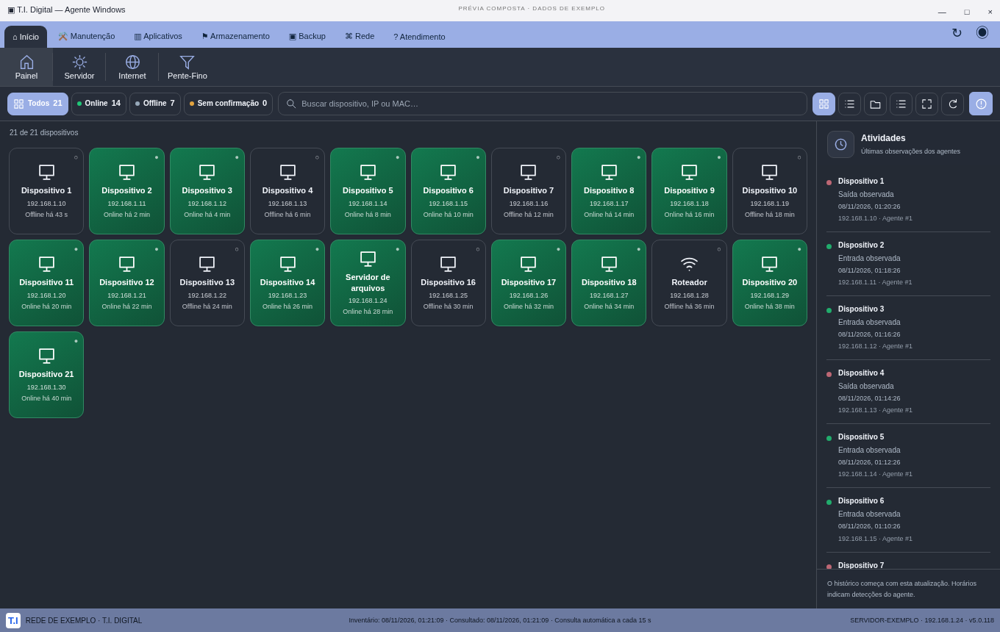
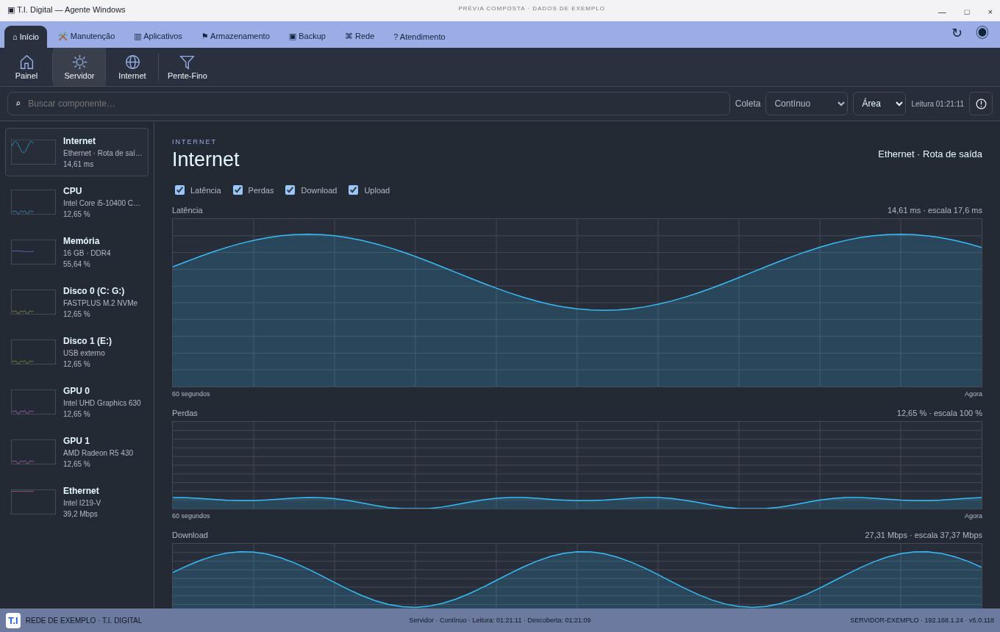
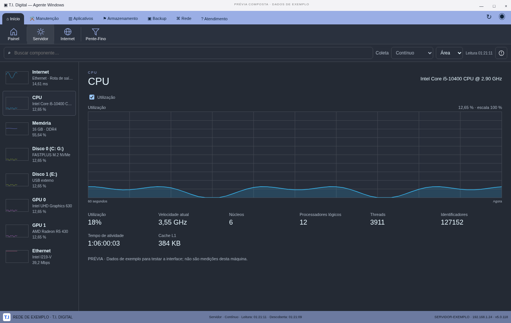
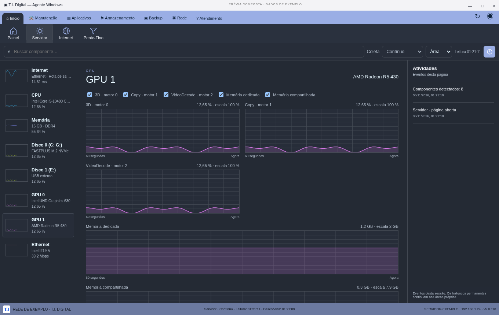

# Painel e Servidor — agente 5.0.118

[**Baixar ZIP para o cPanel**](ATUALIZACAO_WORKSPACE_SERVIDOR_CPANEL.zip) · [Instalação e funcionamento](LEIA_ANTES_WORKSPACE_SERVIDOR.md) · [Código atualizado](codigo) · [Validação](VALIDACAO_WORKSPACE.md)

Imagens compostas, com dados de exemplo. A raiz antiga do repositório permanece separada; os arquivos desta atualização estão em `codigo/`. O snapshot `VALIDACAO_WORKSPACE_WINDOWS.zip` serve para compilar e testar a base integrada, não para extração no site.
